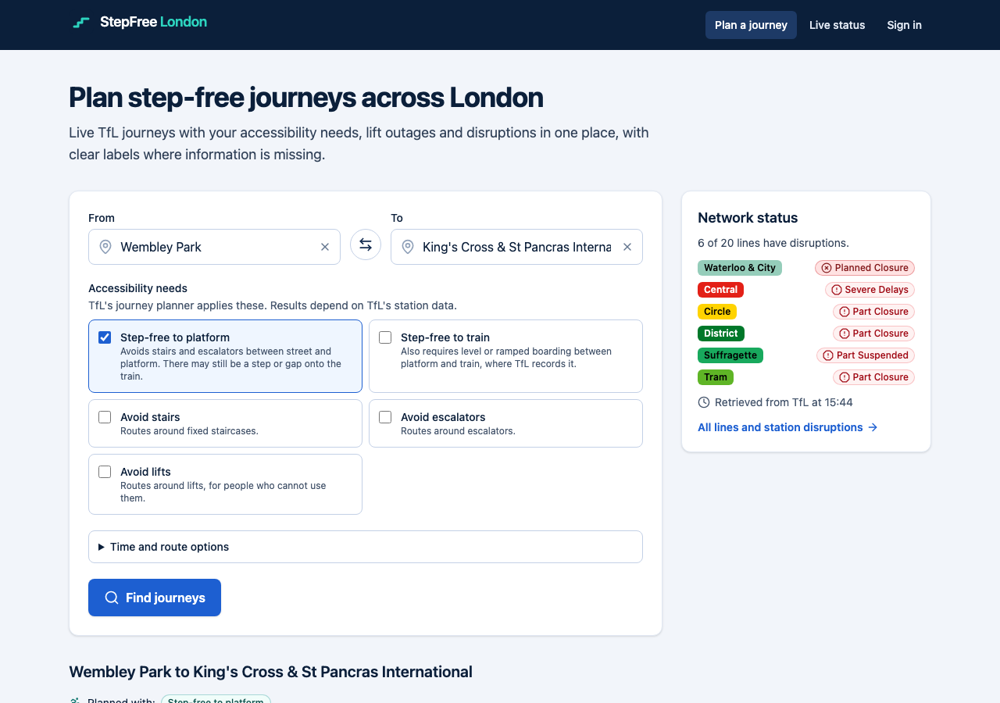
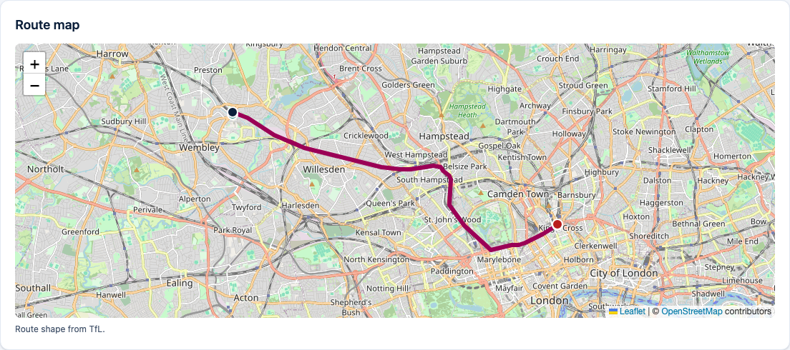
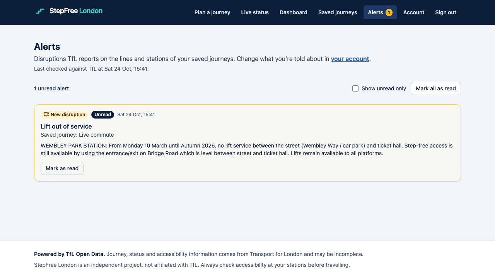
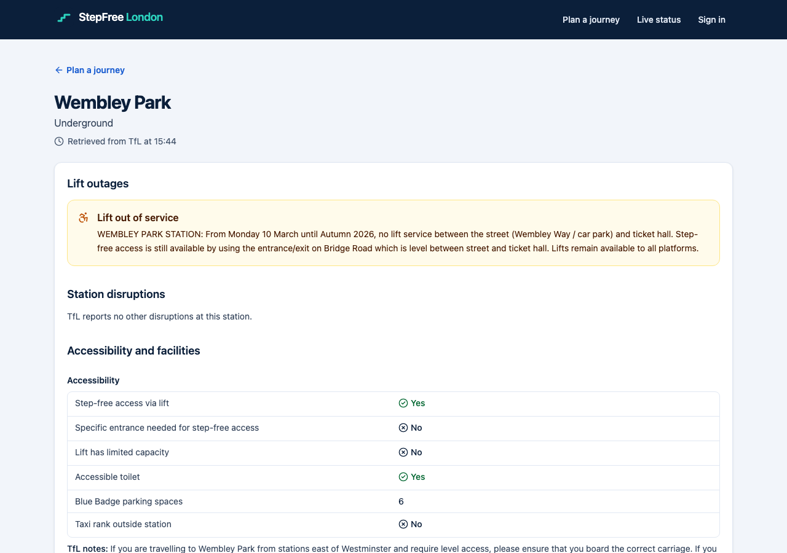

# StepFree London

Accessible journey planning and disruption monitoring for London, built on the official TfL Unified API.

> **Status: all six phases complete.** See [`docs/implementation-checklist.md`](docs/implementation-checklist.md) for what was verified and what is still open.



## The problem

Lift outages, station closures and line disruptions can make a London journey impossible for wheelchair users and people with reduced mobility, and the information is spread across several places. StepFree London plans journeys with TfL's own step-free preferences, shows what is actually known about station accessibility, and watches saved journeys for disruptions that affect the route the user chose.

The app never claims a journey is accessible beyond what TfL's data supports. Missing data is shown as *unavailable*, never as "fine". A feed that can't be read never makes a disruption look resolved.

## Features

- **Step-free journey planning** with TfL's accessibility preferences (step-free to platform or train, avoid stairs, escalators or lifts), plus lifts, stairs and walkways per leg.
- **Station pages**: accessibility facts, facilities, reported lift outages and station disruptions. TfL's cut-off notes are marked as such.
- **Live line status** for Tube, Elizabeth line, Overground, DLR and tram.
- **Route map** drawn only from TfL's route geometry. Nothing is guessed.
- **Accounts and saved journeys**: server-side sessions, CSRF protection, login rate limiting.
- **Monitoring and alerts**: a scheduled cycle compares TfL's feeds with the last state it saw and alerts journeys whose lines or stations are affected. Alerts appear in the app and, if enabled, by email. Each alert is created once (database-enforced), even with concurrent cycles.
- **Accessible UI**: WCAG 2.1 AA checked with axe-core in unit tests and in a real browser (including contrast), keyboard-only flows tested, and screen-reader names asserted.

| Route map | Alerts | Station |
|---|---|---|
|  |  |  |

## Stack

Backend: Java 21 · Spring Boot 4.1 (Web MVC, Security, Session JDBC, Data JPA, JDBC, Mail) · PostgreSQL 17 · Flyway · Caffeine · springdoc-openapi.
Frontend: React 19 · TypeScript · Vite · Tailwind · TanStack Query · React Hook Form + Zod · React Leaflet.
Tests: JUnit 5 · Testcontainers · Vitest · Testing Library · axe-core · Playwright.
Ops: Docker (single image) · GitHub Actions · Dependabot.

## Run locally

Prerequisites: Java 21, Node 22, Docker. Maven isn't needed (wrapper).

```bash
cp .env.example .env          # optional; defaults work for local dev
docker compose up -d          # PostgreSQL :5432, Mailpit SMTP :1025 (inbox UI http://localhost:8025)
cd backend && ./mvnw spring-boot:run          # http://localhost:8080
cd frontend && npm install && npm run dev     # http://localhost:5173 (proxies /api to :8080)
```

Or run the production image: `docker compose --profile app up --build` → http://localhost:8080.

- API docs: http://localhost:8080/swagger-ui.html (off in production)
- No TfL key is needed for development (50 requests/min anonymously). Set `TFL_APP_KEY` for 500/min.

## Tests

```bash
cd backend && ./mvnw verify                          # 172 tests; Docker must be running
cd frontend && npm run lint && npm run typecheck && npm test   # 86 unit tests incl. axe
cd frontend && npx playwright install chromium && npm run test:e2e   # 30 browser tests, API mocked
cd frontend && npm run test:e2e:live                 # full stack against live TfL (see docs/testing.md)
```

## Documentation

- [Feasibility report](docs/feasibility.md): what the TfL API can and can't do, verified against live calls
- [Architecture](docs/architecture.md): modules, auth, monitoring design, frontend
- [TfL integration](docs/api-integration.md)
- [Database](docs/database.md)
- [Testing](docs/testing.md): every suite and every manual verification run
- [Deployment](docs/deployment.md): single image, environment, free hosting plan, monitoring on a sleeping host

Powered by TfL Open Data. Map data © OpenStreetMap contributors.
